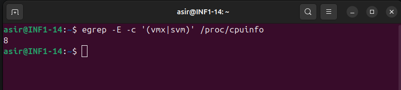
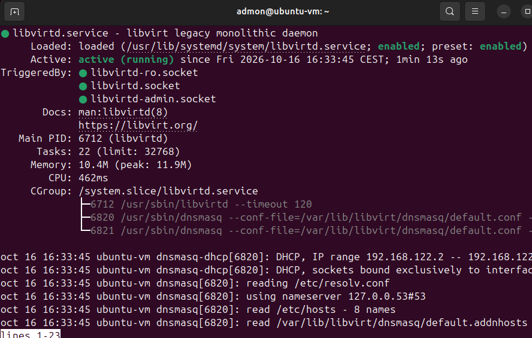

# Héctor Moreno Tejero 2ºASIR

# Ejercicio 1: Verificación del Soporte de Virtualización en el Host

**El objetivo es verificar que el hardware soporta la creación de máquinas virtuales con KVM**

## Instrucciones

- Abrimos una terminal en el sistema Linux

- Ejecutamos el comando:

```bash
egrep -E -c '(vmx|svm)' /proc/cpuinfo
```

- Si el resultado es mayor que 0, la virtualización está habilitada.



# Ejercicio 2: Instalación de KVM y Herramientas de Virtualización

**Desde una distribución Linux instalamos el paquete quemu-kvm, libvirt-bin, y virt-manager y habilitamos el servicio de libvirtd.**

## Instrucciones

- Para instalar estos paquetes ejecutamos:

```bash
sudo apt install qemu-system libvirt-clients libvirt-daemon-system
```

- Habilitamos el servicio con:

```bash
sudo systemctl enable libvirtd
```

- Y lo iniciamos con:

```bash
systemctl start libvirtd
```

Aquí muestro que el servicio está encendido y funcionando:



# Creacion máquina virtual

